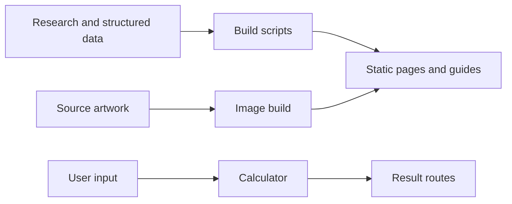

# Technical case study: Crystal Eye

## Problem
A content-rich static website needs consistent calculation conventions, reproducible content generation and reliable asset mapping.

## Approach
Structured JSON, Markdown and PDF research guides support a symbolic numerology calculator and generated topic pages. Python build scripts generate content and optimize source artwork for browser delivery.



## Evaluation
[Calculator tests](tests/numerology-calculator.test.mjs) compare calculations against reference logic and exercise boundary inputs. The [README](README.md) documents image audits and source hashes.

```sh
node --test tests/numerology-calculator.test.mjs
python tests/numerology-pages.py
python scripts/audit_site_images.py
```

## Engineering decisions
Keep calculation conventions explicit, retain original artwork, and mark unfinished content rather than presenting it as complete.

## Limitations
Numerology is a symbolic tradition, not a scientifically validated predictive method. Tests verify implementation conventions, not predictive accuracy. No fresh test run was performed for this case study.

## Resume summary
Implemented structured content generation, reference-based algorithm tests and reproducible asset validation for a static web application.
